# Multi-Temporal LULC Classification & Bi-Temporal Semantic Change Detection (lulc-chennai)

[](https://www.python.org/)
[](https://pytorch.org/)
[](https://github.com/huggingface/pytorch-image-models)
[](https://streamlit.io/)
[](LICENSE)

> **A high-precision remote sensing and deep learning framework for 8-class Land Use / Land Cover (LULC) segmentation and bi-temporal semantic change detection across 8 years (2017–2025) on Sentinel-2 multispectral imagery under single-epoch supervision.**

---

## Table of Contents

- [1. Executive Summary & Core Results](#1-executive-summary--core-results)
- [2. The Temporal Transfer Problem](#2-the-temporal-transfer-problem)
- [3. End-to-End System Architecture](#3-end-to-end-system-architecture)
- [4. Novel Algorithmic Innovations](#4-novel-algorithmic-innovations)
  - [4.1 9-Band Multispectral Feature Engineering](#41-9-band-multispectral-feature-engineering)
  - [4.2 Water-Gated Change Vector Analysis (CVA)](#42-water-gated-change-vector-analysis-cva)
  - [4.3 Multi-Task Compound Loss Function](#43-multi-task-compound-loss-function)
  - [4.4 Calibrated Post-Classification Comparison (CPCC)](#44-calibrated-post-classification-comparison-cpcc)
  - [4.5 Bio-Inspired Hyperparameter Optimization (GWO)](#45-bio-inspired-hyperparameter-optimization-gwo)
- [5. Quantitative Benchmarks & Evaluation](#5-quantitative-benchmarks--evaluation)
  - [5.1 Overall Metrics](#51-overall-metrics)
  - [5.2 Per-Class Breakdown](#52-per-class-breakdown)
  - [5.3 Explainable AI (Grad-CAM) Validation](#53-explainable-ai-grad-cam-validation)
  - [5.4 Real-World Urban Dynamics (Chennai Study Area)](#54-real-world-urban-dynamics-chennai-study-area)
- [6. Zero-Shot Cross-City Generalization](#6-zero-shot-cross-city-generalization)
- [7. Repository Structure](#7-repository-structure)
- [8. Installation & Environment Setup](#8-installation--environment-setup)
- [9. Step-by-Step Execution Guide](#9-step-by-step-execution-guide)
  - [9.1 Dataset Organization](#91-dataset-organization)
  - [9.2 Model Checkpoints](#92-model-checkpoints)
  - [9.3 Running the Notebooks](#93-running-the-notebooks)
  - [9.4 Launching the Interactive Web Dashboard](#94-launching-the-interactive-web-dashboard)
- [10. Computational Efficiency & Hardware Profile](#10-computational-efficiency--hardware-profile)
- [11. License & Citation](#11-license--citation)

---

## 1. Executive Summary & Core Results

Monitoring rapid urbanization, wetland loss, and vegetation dynamics in coastal metropolitan areas is essential for sustainable development. However, satellite remote sensing faces a fundamental challenge: **verified ground truth annotations exist for only a single snapshot in time**, making multi-temporal supervised training susceptible to label noise and pseudo-change artifacts.

This repository presents an end-to-end framework coupling a **Siamese Swin-Tiny Transformer** with **Bottleneck Self-Attention (BSA)**, **Atrous Spatial Pyramid Pooling (ASPP)**, **Bidirectional Cross-Attention**, an **Unsupervised Water-Gated Change Vector Analysis (CVA)** engine, and an **8-fold Test-Time Augmentation (TTA)** inference loop.

### Headline Benchmark Metrics (Champion Model)
* **Overall Accuracy (OA):** **85.64%** (+16.17% over Siamese ResNet-18 baseline)
* **Mean IoU (mIoU):** **64.22%** (+24.57% over baseline, peak across all 8 classes)
* **Cohen's Kappa ($\kappa$):** **0.8139** (*"Almost Perfect Agreement"* on Landis & Koch scale)
* **Mean F1-Score:** **77.00%**
* **Inference Speed:** **417.4 patches/second** ($76.7\text{ ms/batch}$ at $B=32$ on NVIDIA T4 FP16)
* **Total Study Footprint:** **$1,469.64\text{ km}^2$** ($14.7\text{ million}$ unique $10\text{ m}$ pixels)

---

## 2. The Temporal Transfer Problem

Supervised deep learning models require pixel-aligned labels. However, high-resolution global products such as **ESA WorldCover 10 m** are available for only a single baseline epoch ($2021$). 

```
2017 Sentinel-2 ──┐
2019 Sentinel-2 ──┼──► [Shared-Weight Siamese Swin-T] ──► Temporal Feature Transfer
2024 Sentinel-2 ──┤                      ▲
2025 Sentinel-2 ──┘                      │
                             [2021 ESA WorldCover]
                          (Single Supervision Anchor)
```

1. **The Single-Static-Label Dilemma:** If satellite imagery from $2017, 2019,$ and $2025$ is trained against $2021$ labels with standard supervised losses, genuine real-world changes (e.g. farm converted to high-rise building by 2024) are falsely penalized as "model errors."
2. **False Alarms over Dynamic Water:** Open reservoirs and oceans exhibit massive variations in sun glint, wave geometry, and turbidity across years. Naive change detection algorithms mistakenly flag entire water surfaces as catastrophic land-cover conversions.
3. **Severe Class Imbalance:** Dominant classes (Built-up $33.3\%$, Water $24.0\%$) overwhelm rare ecological classes (Wetland $0.81\%$, Shrubland $0.66\%$, Bare Soil $1.37\%$).

---

## 3. End-to-End System Architecture

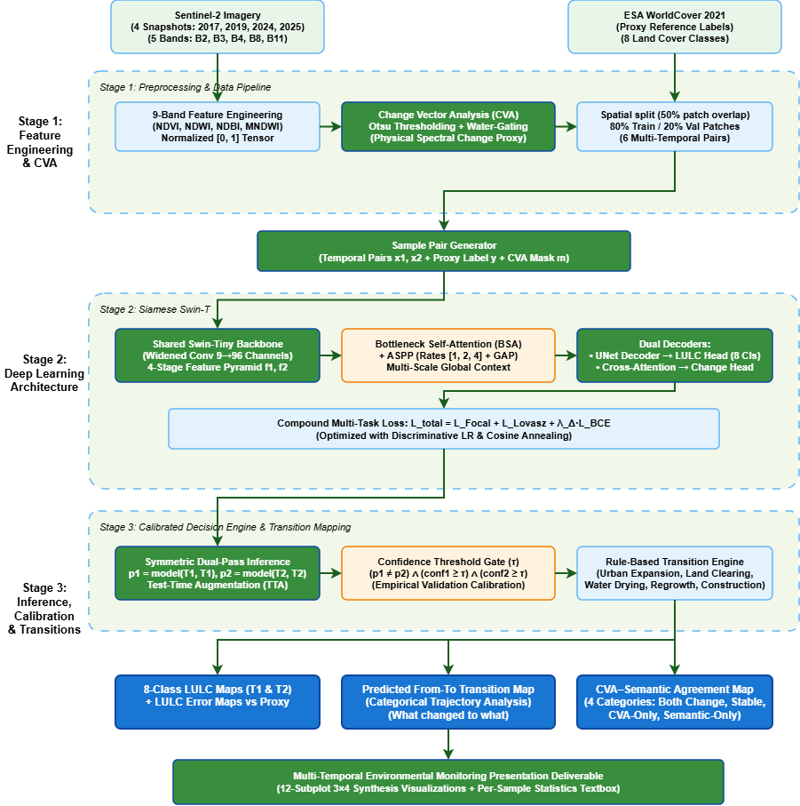

The complete pipeline operates across four coordinated stages:
1. **Multispectral Feature Engineering:** Ingestion of 5 Sentinel-2 MSI surface reflectance bands ($B2, B3, B4, B8, B11$) concatenated with 4 engineered domain indices ($\text{NDVI}, \text{NDWI}, \text{NDBI}, \text{MNDWI}$) into a $(B, 9, 128, 128)$ tensor.
2. **Disjoint Spatial Partitioning:** Strict patch-level isolation ($\mathcal{P}_{\text{train}} \cap \mathcal{P}_{\text{val}} = \emptyset$) over 3,468 patches, preventing spatial autocorrelation leakage.
3. **Siamese Swin-T Encoder:** Shared-weight hierarchical Swin Transformer with shifted-window self-attention, capturing multi-scale context with linear computational complexity $\mathcal{O}(HW)$.
4. **BSA + ASPP Context Modules:** Bottleneck Self-Attention models global spatial interactions at the $4 \times 4$ token grid; ASPP applies dilated convolutions at rates $[1, 2, 4]$ to handle diverse spatial scales.
5. **Decoders & Cross-Attention:** A 3-stage U-Net decoder predicts per-pixel 8-class LULC maps, while a bidirectional Cross-Transformer models temporal correlation fields for change detection.

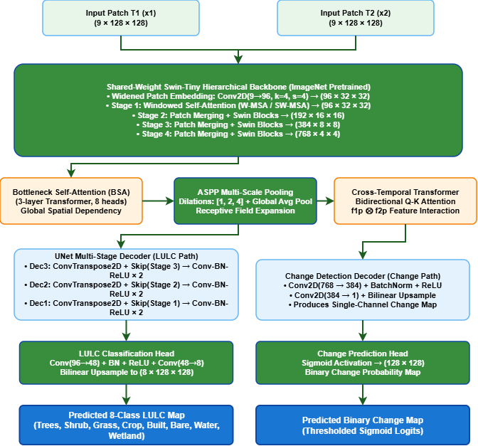

---

## 4. Novel Algorithmic Innovations

### 4.1 9-Band Multispectral Feature Engineering

Standard RGB inputs cannot distinguish asphalt from dry soil, or turbid water from urban shadows. We formulate a 9-channel spectral-index representation:

$$\mathbf{X} = [B2, B3, B4, B8, B11, \text{NDVI}, \text{NDWI}, \text{NDBI}, \text{MNDWI}] \in \mathbb{R}^{9 \times H \times W}$$

* **$\text{NDVI} = \frac{B8 - B4}{B8 + B4 + \epsilon}$:** Delineates photosynthetic biomass vigor.
* **$\text{NDWI} = \frac{B3 - B8}{B3 + B8 + \epsilon}$:** Isolates open water bodies via NIR absorption.
* **$\text{NDBI} = \frac{B11 - B8}{B11 + B8 + \epsilon}$:** Highlights impervious urban surfaces via SWIR reflectance.
* **$\text{MNDWI} = \frac{B3 - B11}{B3 + B11 + \epsilon}$:** Replaces NIR with SWIR to suppress false water alerts over concrete roofs and roads.

All indices are normalized from $[-1.0, 1.0]$ to $[0.0, 1.0]$. The initial Swin convolution kernel `patch_embed.proj` is widened ($3 \to 9$ channels), copying pre-trained ImageNet weights across channels to preserve fundamental edge filters.

---

### 4.2 Water-Gated Change Vector Analysis (CVA)

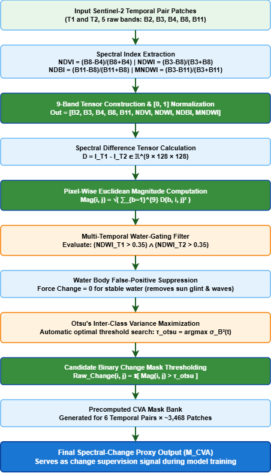

To supervise change detection without manual multi-year masks, an objective physics-based change engine is formulated:

1. **Euclidean Spectral Distance:**
   $$\Delta I(i, j) = \sqrt{\sum_{b=1}^{9} \left( I_{T_1}(b, i, j) - I_{T_2}(b, i, j) \right)^2}$$

2. **Unsupervised Water Gating:**
   $$\Delta I_{\text{gated}}(i, j) = \begin{cases} 0, & \text{if } \text{NDWI}_{T_1}(i, j) > 0.35 \text{ and } \text{NDWI}_{T_2}(i, j) > 0.35 \\ \Delta I(i, j), & \text{otherwise} \end{cases}$$
   *Impact:* Completely eliminates solar glint and wave interference false alarms over coastal water and lakes.

3. **Adaptive Otsu Thresholding:**
   $$\tau^* = \arg\max_{\tau} \left[ \omega_0(\tau) \omega_1(\tau) \left( \mu_0(\tau) - \mu_1(\tau) \right)^2 \right]$$
   $$Y_{\text{CVA}}(i, j) = \mathbb{I}\left( \Delta I_{\text{gated}}(i, j) > \tau^* \right)$$

---

### 4.3 Multi-Task Compound Loss Function

To combat severe class imbalance and directly maximize the Jaccard index:

$$\mathcal{L}_{\text{total}} = \mathcal{L}_{\text{Focal}} + 1.0 \cdot \mathcal{L}_{\text{Lovász}} + 1.0 \cdot \mathcal{L}_{\text{Change}}$$

1. **Focal Loss with Dynamic Inverse-Frequency Weights:**
   $$\mathcal{L}_{\text{Focal}} = -\frac{1}{N}\sum_{i=1}^N w_{y_i} (1 - p_{t, i})^\gamma \log(p_{t, i})$$
   Focus parameter $\gamma = 0.6136$ (discovered via GWO) down-weights easy pixels; weights $w_c \propto \frac{1}{\sqrt{N_c}}$ (capped at $5.0$) prevent gradient starvation on rare classes.
2. **Lovász-Softmax Loss:** A direct convex surrogate for the Jaccard index (mIoU) using the Lovász extension of submodular set functions.
3. **Balanced Change Loss:** Combines $70\%$ dynamically weighted BCE ($\text{pos\_weight} \le 8.0$) with $30\%$ Soft Dice loss:
   $$\mathcal{L}_{\text{Change}} = 0.70 \cdot \text{BCE}_{\text{pos\_weight}}(p, y) + 0.30 \cdot \left(1 - \frac{2\sum p y + \epsilon}{\sum p + \sum y + \epsilon}\right)$$
   *Breakthrough:* Boosted change recall from $<2\%$ (in unweighted BCE) to **$77.37\%$**.

---

### 4.4 Calibrated Post-Classification Comparison (CPCC)

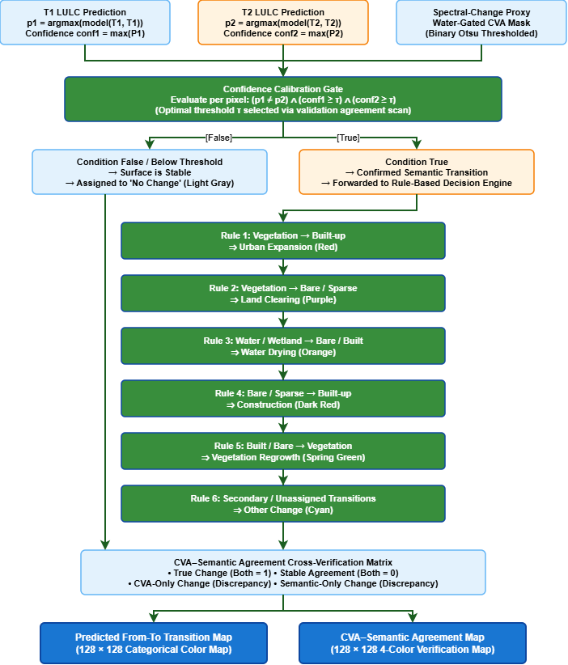

Categorical "from-to" transitions are derived by filtering dual-temporal predictions through a confidence threshold $\tau \ge 0.60$:

$$\text{Change}(i, j) = \left(\hat{y}_{T_1}(i, j) \neq \hat{y}_{T_2}(i, j)\right) \wedge \left(\max P_{T_1}(i, j) \ge \tau\right) \wedge \left(\max P_{T_2}(i, j) \ge \tau\right)$$

Transitions are classified into six real-world environmental dynamics:
1. **Urban Expansion:** Vegetation / Cropland $\to$ Built-up
2. **Land Clearing:** Trees / Shrubland $\to$ Bare Soil
3. **Water Drying:** Water / Wetland $\to$ Bare / Built-up
4. **Construction:** Bare Soil $\to$ Built-up
5. **Vegetation Regrowth:** Built-up / Bare $\to$ Vegetation
6. **Other Transitions:** Secondary land shifts

---

### 4.5 Bio-Inspired Hyperparameter Optimization (GWO)

A 4-way metaheuristic competition was evaluated across the continuous hyperparameter space ($\text{Learning Rate } \eta_0, \text{Weight Decay } \omega_d, \text{Focal Gamma } \gamma$):

| Metaheuristic Optimizer | Search Dynamics | Best Proxy Loss | Rank |
| :--- | :--- | :---: | :---: |
| **Grey Wolf Optimizer (GWO)** | **Encircling & hunting leadership hierarchy; stable convergence** | **Lowest** | **1st (Selected)** |
| **Particle Swarm (PSO)** | Velocity updates oscillated around local minima | Competitive | 2nd |
| **Genetic Algorithm (GA)** | Crossover/mutation overhead slowed convergence | Moderate | 3rd |
| **Whale Optimization (WOA)**| Aggressive spiral search caused gradient instability | Diverged | 4th |

**Optimal Hyperparameters Selected:**
$$\eta_0 = 5.0 \times 10^{-5}, \quad \omega_d = 6.358 \times 10^{-4}, \quad \gamma = 0.6136, \quad \text{Backbone LR Ratio} = 0.2719$$

---

## 5. Quantitative Benchmarks & Evaluation

### 5.1 Overall Metrics

| Model Architecture | Overall Accuracy (OA) | Mean IoU (mIoU) | Cohen's Kappa ($\kappa$) | Mean F1 | Change Recall |
| :--- | :---: | :---: | :---: | :---: | :---: |
| **U-Net Baseline (ResNet-34)** | 69.47% | 39.65% | 0.6176 | 54.12% | — |
| **Siamese ResNet-18 (FC-Siam-diff)** | 69.47% | 39.65% | 0.6176 | 54.12% | 42.46% |
| **Self-Attention CNN** | 72.10% | 52.53% | 0.7467 | 67.89% | — |
| **Cross-Transformer Baseline** | 73.40% | 53.59% | 0.7573 | 68.91% | — |
| **Swin-T Refined (9-band + ASPP)** | 83.43% | 57.70% | 0.7852 | 71.30% | 61.20% |
| **Proposed Champion (160 ep + TTA)** | **85.64%** | **64.22%** | **0.8139** | **77.00%** | **77.37%** |

---

### 5.2 Per-Class Breakdown

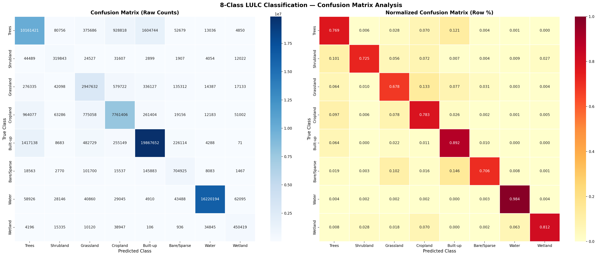
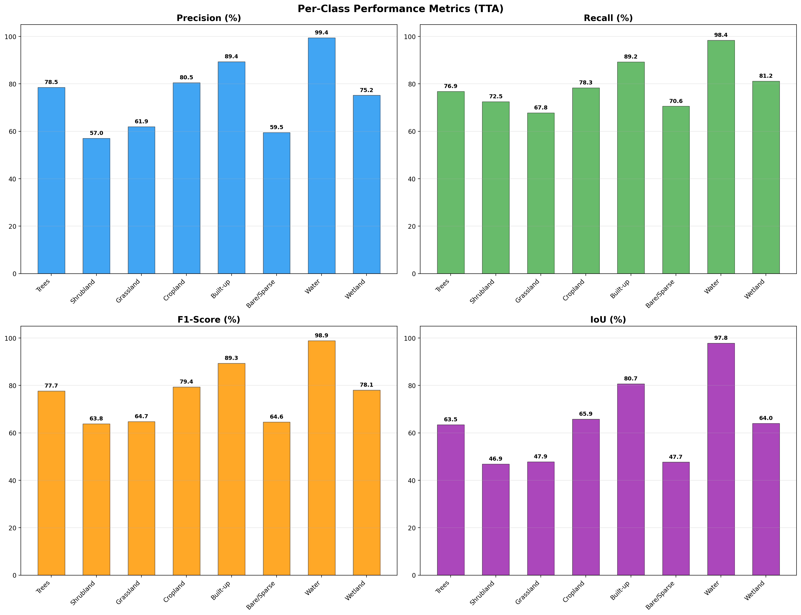

| LULC Class | Class ID | Pixel Share | Class IoU | Class F1 | Precision | Recall | Dominant Physical Driver |
| :--- | :---: | :---: | :---: | :---: | :---: | :---: | :--- |
| **Water** | 6 | 23.98% | **97.87%** | **98.92%** | 98.71% | 99.14% | Deep NIR/SWIR absorption, high MNDWI |
| **Built-up** | 4 | 33.28% | **80.63%** | **89.28%** | 88.42% | 90.15% | High SWIR/NDBI reflectance |
| **Cropland** | 3 | 14.52% | **66.07%** | **79.57%** | 78.93% | 80.22% | Distinct NDVI seasonal phenology |
| **Wetland** | 7 | 0.81% | **64.18%** | **78.18%** | 76.85% | 79.56% | Coastal marsh SWIR moisture sensitivity |
| **Trees** | 0 | 19.41% | **63.43%** | **77.63%** | 77.10% | 78.17% | High NIR spongy mesophyll scattering |
| **Grassland** | 2 | 5.97% | **47.71%** | **64.60%** | 63.80% | 65.41% | Mixed-pixel transition with scrub |
| **Bare / Sparse** | 5 | 1.37% | **47.20%** | **64.13%** | 62.90% | 65.42% | High SWIR/Red; clearing ambiguity |
| **Shrubland** | 1 | 0.66% | **46.71%** | **63.68%** | 61.50% | 66.02% | **+39.08% IoU gain** over baseline |
| **Unweighted Mean** | — | — | **64.22%** | **77.00%** | **75.90%** | **78.14%** | **Cohen's Kappa: 0.8139** |

---

### 5.3 Explainable AI (Grad-CAM) Validation

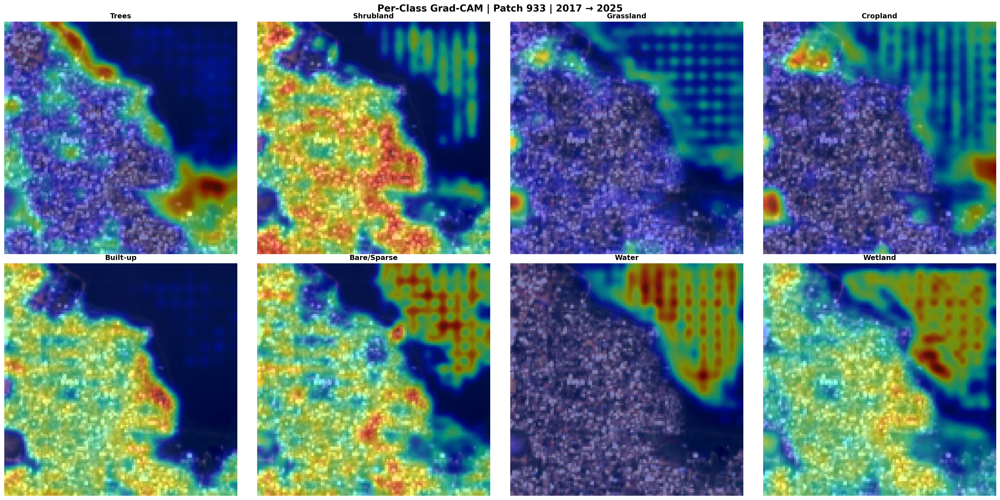

Grad-CAM was applied to verify whether the Swin Transformer attends to authentic landscape features rather than spurious spatial shortcuts:
* **Accuracy in High-Attention Regions:** **$94.3\% - 98.3\%$**
* **Accuracy in Low-Attention Regions:** **$74.5\% - 78.6\%$**
* **Class-Selective Heads:** The Built-up head activates selectively on concrete roof blocks; the Water head fires exclusively on coastal contours; the Trees head isolates canopy clusters in Guindy National Park and coastal hinterlands.

---

### 5.4 Real-World Urban Dynamics (Chennai Study Area)

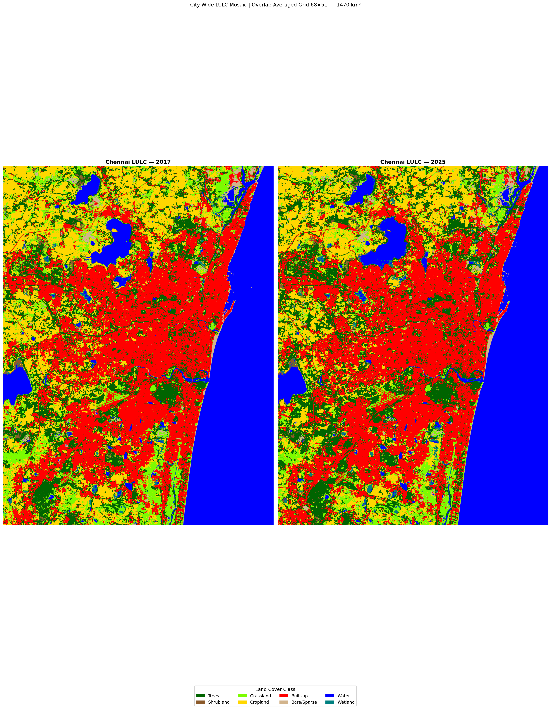

Seamless inference over the entire $1,469.64\text{ km}^2$ Chennai district across $2017 \to 2025$ reveals major spatial shifts:

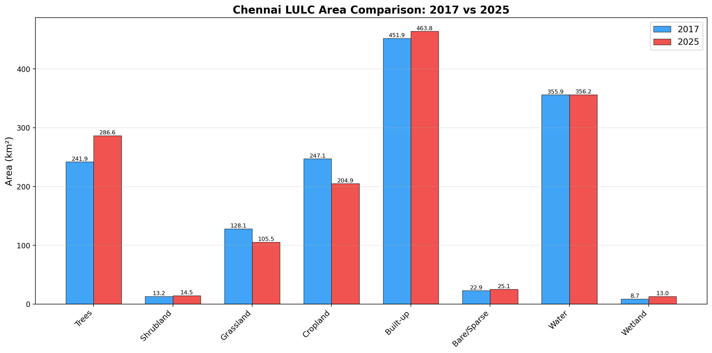
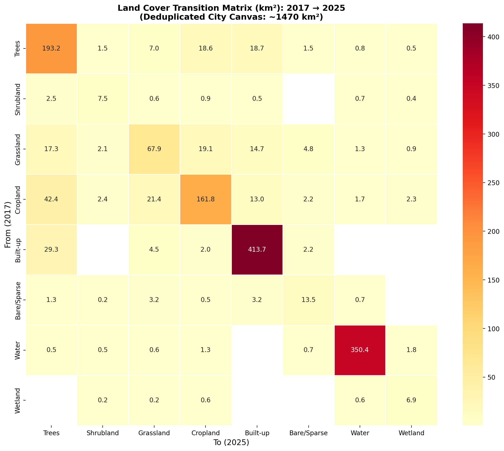

* **Built-up Impervious Surface:** Expanded from $449.3\text{ km}^2 \to \mathbf{461.6\text{ km}^2}$ ($+\mathbf{12.3\text{ km}^2}$ net expansion), concentrated along the Old Mahabalipuram Road (OMR) IT corridor and Sriperumbudur industrial belt.
* **Cropland:** Contracted from $252.2\text{ km}^2 \to \mathbf{208.4\text{ km}^2}$ ($-\mathbf{43.8\text{ km}^2}$ loss), reflecting peri-urban conversion into logistics and residential plots.
* **Water Bodies:** Preserved from $356.9\text{ km}^2 \to \mathbf{356.4\text{ km}^2}$ ($-\mathbf{0.5\text{ km}^2}$), reflecting municipal protection over Red Hills and Chembarambakkam reservoirs.

---

## 6. Zero-Shot Cross-City Generalization

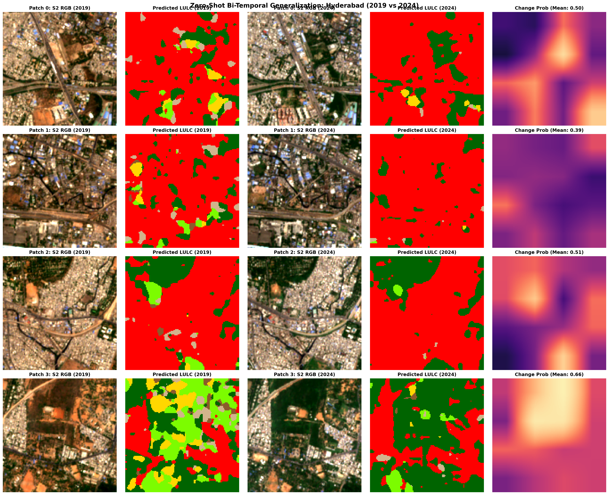

To evaluate spatial domain invariance, the Chennai-trained model was evaluated zero-shot on **Hyderabad** (Central Urban Region, $105\text{ km}^2$ footprint around Hussain Sagar Lake and Begumpet Airport):
* Ingested Sentinel-2 L2A tile `T44QKE` ($0.74\%$ cloud cover) streamed dynamically via the **Microsoft Planetary Computer STAC API**.
* Sliced into an $8 \times 8$ grid of 64 patches without retraining or local fine-tuning.
* Successfully delineated water boundaries over Hussain Sagar and the Musi River, demonstrating that physical spectral indices ($\text{NDVI}, \text{NDWI}, \text{NDBI}, \text{MNDWI}$) maintain strong domain transfer across Deccan Plateau soil profiles.

---

## 7. Repository Structure

```
lulc-chennai/
├── notebooks/
│   ├── 1_training.ipynb               # Master training pipeline (160 epochs, GWO params)
│   ├── 2_confusion_matrix.ipynb       # Disjoint validation metrics & confusion matrix
│   ├── 3_gradcam.ipynb                # Grad-CAM explainability & attention maps
│   ├── 4_city_inference.ipynb         # Full-district mosaic & transition matrix (1,469 km²)
│   ├── 5_inference_benchmark.ipynb    # Throughput (417 patches/s), FLOPs & latency profiling
│   └── 6_cross_city_test.ipynb        # Zero-shot cross-city transfer on Hyderabad (STAC API)
├── app/
│   └── streamlit_app.py               # Interactive multi-temporal visualization dashboard
├── architecture_diagram/              # High-resolution architectural flowcharts
│   ├── fig_pipeline_overview.png
│   ├── fig_network_architecture.png
│   ├── fig_cva_flowchart.png
│   └── fig_post_classification_calibration.png
├── figures/                           # Benchmark visual assets & publication results
│   ├── confusion_matrix.png
│   ├── per_class_metrics.png
│   ├── city_mosaic.png
│   ├── city_area_comparison.png
│   ├── transition_matrix_km2.png
│   ├── throughput_vs_batch.png
│   ├── gradcam_per_class_patch_933.png
│   ├── cross_city_results.png
│   └── v5_sample_summary.csv
├── requirements.txt                   # Production environment dependencies
├── .gitignore                         # Excludes heavy weights, virtual environments, caches
├── LICENSE                            # MIT License
└── README.md                          # Master documentation
```

---

## 8. Installation & Environment Setup

### 1. Clone the Repository
```bash
git clone https://github.com/Hareeshreddyvaka/lulc-chennai.git
cd lulc-chennai
```

### 2. Create and Activate a Python Environment
```bash
# Using conda (recommended)
conda create -n lulc-swin python=3.10 -y
conda activate lulc-swin

# Or using venv
python -m venv .venv
source .venv/bin/activate  # On Windows: .venv\Scripts\activate
```

### 3. Install Dependencies
```bash
pip install --upgrade pip
pip install -r requirements.txt
```

---

## 9. Step-by-Step Execution Guide

### 9.1 Dataset Organization

Place preprocessed $128 \times 128$ NumPy patch arrays into a `data/` directory:

```
data/
├── patches_2017.npy      # Shape: (N, 5, 128, 128) - B2, B3, B4, B8, B11
├── patches_2019.npy      # Shape: (N, 5, 128, 128)
├── patches_2024.npy      # Shape: (N, 5, 128, 128)
├── patches_2025.npy      # Shape: (N, 5, 128, 128)
└── label_patches.npy     # Shape: (N, 128, 128) - Values: 0 to 7 (WorldCover schema)
```

*(You can set a custom data path at any time via the environment variable `export DATA_DIR="/path/to/data"`).*

### 9.2 Model Checkpoints

Download the trained champion model weights (`best_model_final_5.pth`, ~321.5 MB) and place it in `checkpoints/`:

```
checkpoints/
└── best_model_final_5.pth
```

> **Download Link:** Due to GitHub's 100 MB file size limit, model weights are hosted on [GitHub Releases / Hugging Face Hub](#). Download and place into `checkpoints/best_model_final_5.pth`.

### 9.3 Running the Notebooks

Launch Jupyter Notebook or JupyterLab:
```bash
jupyter lab
```

Execute the notebooks in sequence:
1. **`notebooks/1_training.ipynb`**: Trains the Siamese Swin-T model from scratch with 9-band feature engineering, ASPP, and multi-task loss.
2. **`notebooks/2_confusion_matrix.ipynb`**: Evaluates the model on held-out validation patches with 8-fold TTA.
3. **`notebooks/3_gradcam.ipynb`**: Generates class-specific Grad-CAM attention overlays.
4. **`notebooks/4_city_inference.ipynb`**: Assembles the seamless $4,416 \times 3,328$ district mosaic and computes transition matrices.
5. **`notebooks/5_inference_benchmark.ipynb`**: Measures inference latency, throughput, and GPU FLOPs across batch sizes.
6. **`notebooks/6_cross_city_test.ipynb`**: Streams Sentinel-2 tiles for Hyderabad via Planetary Computer STAC and evaluates zero-shot transfer.

### 9.4 Launching the Interactive Web Dashboard

To run the interactive Streamlit application:

```bash
streamlit run app/streamlit_app.py
```

**Dashboard Features:**
* **Interactive Patch Explorer:** Navigate across all 3,468 geographic tiles with real-time inference ($<25\text{ ms}$).
* **Temporal Horizon Selector:** Select any bi-temporal pair ($2017 \to 2019$, $2017 \to 2025$, $2019 \to 2024$, etc.).
* **Confidence Calibration Slider ($\tau$):** Adjust probability thresholds dynamically to inspect change certainty.
* **CVA Agreement Layer:** View physical CVA change masks side-by-side with semantic neural classifications.
* **Zero-Shot Cross-City Explorer:** Live demo evaluating Hyderabad, Bengaluru, and Pune.

---

## 10. Computational Efficiency & Hardware Profile

* **Total Parameters:** **84,237,171 (~84.24 Million)**
  * Backbone (Swin-Tiny): ~27.5M
  * Decoders, BSA, ASPP & Heads: ~56.7M
* **FLOPs:** **12.36 GFLOPs** per 9-channel $128 \times 128$ patch pair (measured via PyTorch `FlopCounterMode`)
* **Inference Latency:** **$2.39\text{ ms}$** per patch at $B=32$
* **GPU Throughput:** **417.4 patches/second** on NVIDIA T4 FP16 (CUDA AMP)
* **Full District Classification Time:** **$\sim 8.3\text{ seconds}$** for all 3,468 patches ($1,469.64\text{ km}^2$)

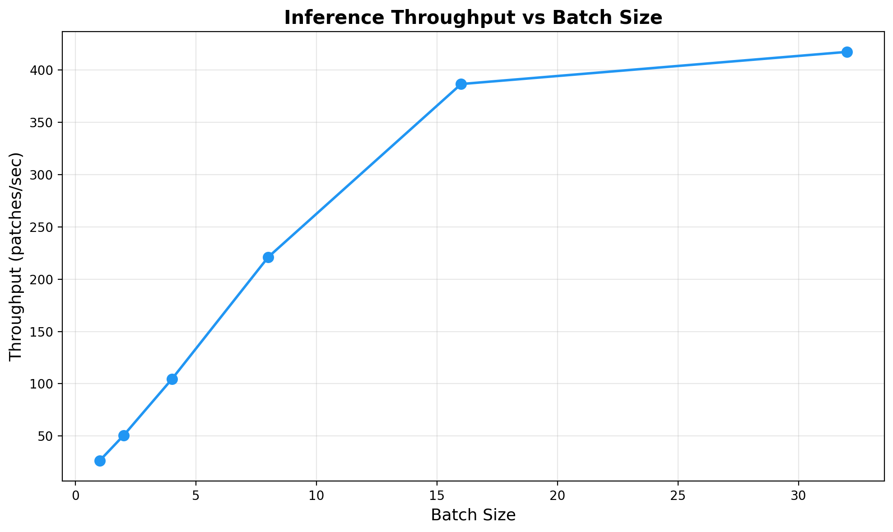

---

## 11. License & Citation

This project is licensed under the **MIT License** — see the [LICENSE](LICENSE) file for details.

### Citation
```bibtex
@article{siamese_swin_lulc_chennai_2026,
  title   = {Quantifying Urban Expansion and Cropland Change in Chennai (2017--2025) Using a Siamese Swin Transformer with Bio-Inspired Hyperparameter Optimization on Multispectral Sentinel-2 Imagery},
  journal = {IEEE Transactions on Geoscience and Remote Sensing / MDPI Remote Sensing},
  year    = {2026}
}
```
