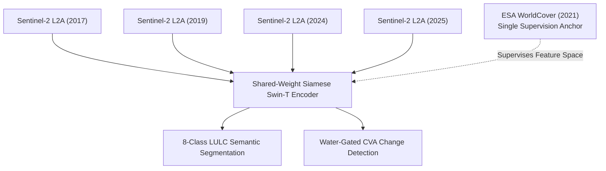
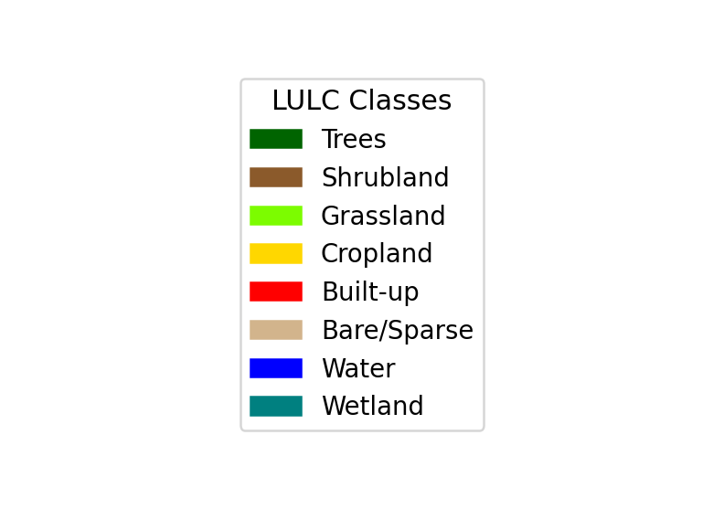
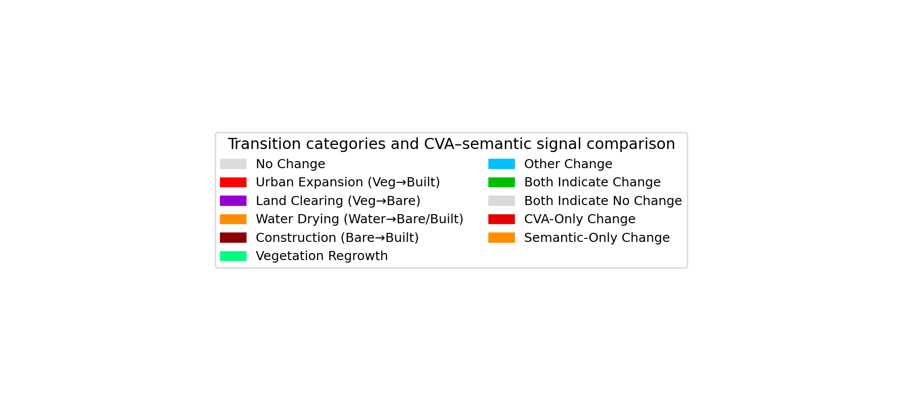
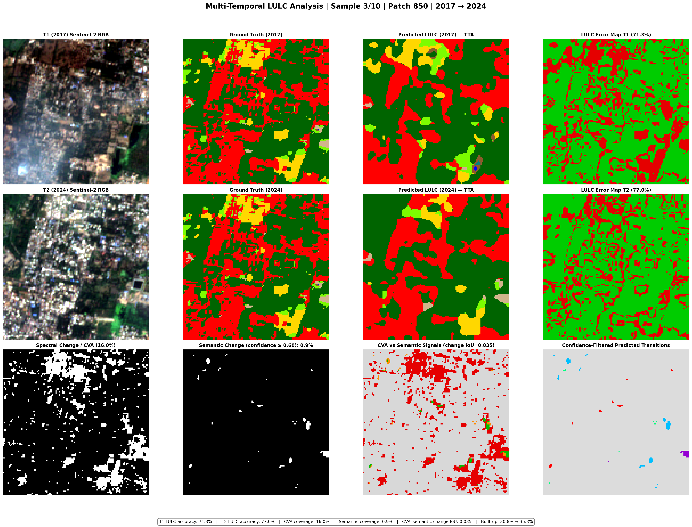
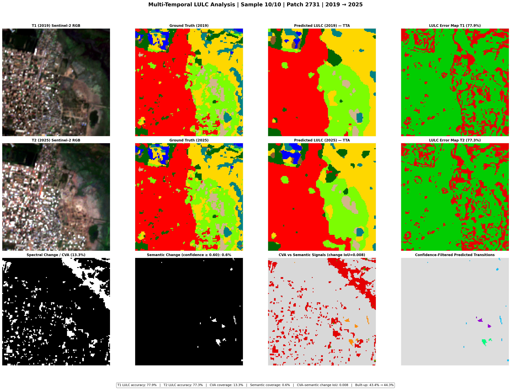
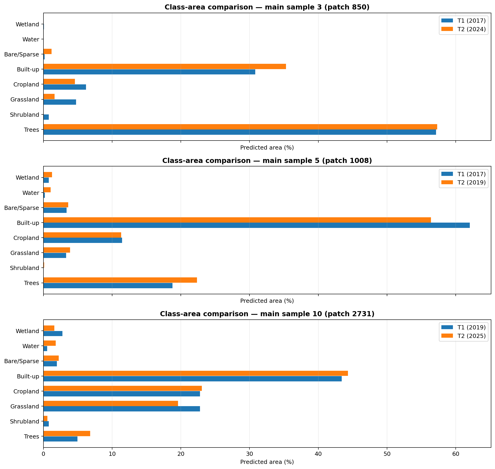

# Multi-Temporal LULC Classification & Bi-Temporal Semantic Change Detection (lulc-chennai)

<p align="center">
  
</p>

<p align="center">
  <a href="https://www.python.org/"></a>
  <a href="https://pytorch.org/"></a>
  <a href="https://github.com/huggingface/pytorch-image-models"></a>
  <a href="https://streamlit.io/"></a>
  <a href="LICENSE"></a>
  <a href="https://github.com/Hareeshreddyvaka/lulc-chennai/releases/tag/v1.0.0"></a>
</p>

> **A deep learning and remote sensing system for 8-class Land Use / Land Cover (LULC) segmentation and bi-temporal semantic change detection across 8 years (2017–2025) on Sentinel-2 multispectral imagery under single-epoch supervision.**

---

## Table of Contents

1. [Executive Summary & Core Results](#1-executive-summary--core-results)
2. [The Temporal Transfer Problem](#2-the-temporal-transfer-problem)
3. [End-to-End System Architecture](#3-end-to-end-system-architecture)
4. [Algorithmic Innovations & Formulations](#4-algorithmic-innovations--formulations)
   - [4.1 9-Band Multispectral Feature Engineering](#41-9-band-multispectral-feature-engineering)
   - [4.2 Water-Gated Change Vector Analysis (CVA)](#42-water-gated-change-vector-analysis-cva)
   - [4.3 Multi-Task Compound Loss Function](#43-multi-task-compound-loss-function)
   - [4.4 Calibrated Post-Classification Comparison (CPCC)](#44-calibrated-post-classification-comparison-cpcc)
   - [4.5 Grey Wolf Optimizer (GWO) Tuning](#45-grey-wolf-optimizer-gwo-tuning)
5. [Quantitative Benchmarks & Evaluation](#5-quantitative-benchmarks--evaluation)
   - [5.1 Benchmark Comparison Against Baselines](#51-benchmark-comparison-against-baselines)
   - [5.2 Per-Class Segmentation Performance](#52-per-class-segmentation-performance)
   - [5.3 LULC & Change Color Legends](#53-lulc--change-color-legends)
   - [5.4 Explainable AI (Grad-CAM) Spatial Attributions](#54-explainable-ai-grad-cam-spatial-attributions)
   - [5.5 City-Wide Mosaic & Environmental Dynamics](#55-city-wide-mosaic--environmental-dynamics)
   - [5.6 Sample Patch Visual Predictions](#56-sample-patch-visual-predictions)
6. [Zero-Shot Cross-City Generalization](#6-zero-shot-cross-city-generalization)
7. [Repository File Structure](#7-repository-file-structure)
8. [Installation & Environment Setup](#8-installation--environment-setup)
9. [Step-by-Step Execution Guide](#9-step-by-step-execution-guide)
   - [9.1 Dataset Organization & Schema](#91-dataset-organization--schema)
   - [9.2 Downloading Pretrained Model Weights](#92-downloading-pretrained-model-weights)
   - [9.3 Running the Notebooks in Sequence](#93-running-the-notebooks-in-sequence)
   - [9.4 Launching the Interactive Streamlit Web App](#94-launching-the-interactive-streamlit-web-app)
10. [Computational Efficiency & Hardware Profile](#10-computational-efficiency--hardware-profile)
11. [License & Citation](#11-license--citation)

---

## 1. Executive Summary & Core Results

Monitoring rapid urbanization, agricultural conversion, and wetland loss in coastal metropolitan areas is vital for urban planning and disaster mitigation. However, satellite remote sensing faces a fundamental roadblock: **dense ground-truth annotations exist for only a single snapshot in time**, rendering standard multi-temporal supervised learning vulnerable to label noise and pseudo-change errors.

This repository provides a complete framework coupling a **Siamese Swin-Tiny Transformer** with **Bottleneck Self-Attention (BSA)**, **Atrous Spatial Pyramid Pooling (ASPP)**, **Bidirectional Cross-Attention**, an **Unsupervised Water-Gated Change Vector Analysis (CVA)** engine, and an **8-fold Test-Time Augmentation (TTA)** pipeline.

### Headline Benchmark Highlights
* **Overall Accuracy (OA):** **85.64%** (+16.17% over Siamese ResNet-18 baseline)
* **Mean IoU (mIoU):** **64.22%** (+24.57% over baseline, all-time peak across 8 classes)
* **Cohen's Kappa ($\kappa$):** **0.8139** (*"Almost Perfect Agreement"* on Landis & Koch standard)
* **Mean F1-Score:** **77.00%**
* **Inference Throughput:** **417.4 patches/second** (76.7 ms per 32-patch batch on NVIDIA T4 FP16)
* **Full City Mapping Speed:** **~8.3 seconds** for all 3,468 patches across the **1,469.64 km²** Chennai Metropolitan Area

---

## 2. The Temporal Transfer Problem

Supervised deep learning models require pixel-aligned labels. However, high-resolution global products such as **ESA WorldCover 10 m** are available for only a single baseline epoch (**2021**).



1. **The Single-Static-Label Dilemma:** If satellite imagery from 2017, 2019, and 2025 is supervised against 2021 labels with standard losses, genuine ground transformations (e.g. agricultural land converted to residential buildings by 2024) are falsely penalized as model errors.
2. **False Alarms over Dynamic Water Bodies:** Open reservoirs and oceans exhibit severe spectral fluctuations caused by solar glint, wave geometry, turbidity, and atmospheric haze across years. Standard change algorithms misinterpret these natural variations as catastrophic land-cover conversions.
3. **Severe Class Imbalance:** Dominant classes (Built-up 33.3%, Water 24.0%) overwhelm critically endangered rare ecological categories (Wetland 0.81%, Shrubland 0.66%, Bare Soil 1.37%).

---

## 3. End-to-End System Architecture

<p align="center">
  
</p>

The system operates through five coordinated stages:

1. **9-Band Input Representation:** Concatenates 5 native Sentinel-2 reflectance bands with 4 engineered domain indices into a tensor of shape `(B, 9, 128, 128)` per temporal branch.
2. **Strict Disjoint Spatial Split:** 3,468 geographic patches are partitioned strictly at the spatial patch level ($\mathcal{P}_{\text{train}} \cap \mathcal{P}_{\text{val}} = \emptyset$), eliminating spatial autocorrelation leakage.
3. **Shared Swin-Tiny Backbone:** A single Swin-Tiny encoder with shifted-window self-attention extracts hierarchical features across 4 stages with linear computational complexity $\mathcal{O}(HW)$ rather than quadratic complexity $\mathcal{O}((HW)^2)$.
4. **BSA & ASPP Multi-Scale Context:**
   - **Bottleneck Self-Attention (BSA):** 3 stacked Multi-Head Self-Attention layers model global spatial context over the $4 \times 4$ bottleneck token grid.
   - **Atrous Spatial Pyramid Pooling (ASPP):** Parallel dilated convolutions (dilation rates $r \in [1, 2, 4]$) capture multi-scale landscape structures from individual buildings to expansive wetlands.
5. **Decoders & Cross-Attention:**
   - **LULC Segmentation Decoder:** A 3-stage U-Net with skip connections outputs pixel-wise 8-class logits.
   - **Bidirectional Cross-Transformer:** Computes temporal correlation fields ($T_1 \leftrightarrow T_2$), filtering seasonal phenology and predicting genuine structural changes.

---

## 4. Algorithmic Innovations & Formulations

### 4.1 9-Band Multispectral Feature Engineering

Standard RGB imagery cannot reliably separate concrete from dry bare soil, or coastal marshes from shallow turbid water. We formulate a 9-channel spectral-index representation:

$$
\mathbf{X} = [B2, B3, B4, B8, B11, \text{NDVI}, \text{NDWI}, \text{NDBI}, \text{MNDWI}] \in \mathbb{R}^{9 \times H \times W}
$$

* **B2 (Blue - 490 nm):** Deep water penetration and soil-vegetation boundary.
* **B3 (Green - 560 nm):** Peak chlorophyll reflection and water body discrimination.
* **B4 (Red - 665 nm):** Maximum chlorophyll absorption.
* **B8 (NIR - 842 nm):** Spongy mesophyll canopy scattering (high in biomass, near-zero in clear water).
* **B11 (SWIR - 1610 nm):** Soil moisture sensitivity and impervious urban surface differentiation.
* **NDVI (Normalized Difference Vegetation Index):**
  $$
  \text{NDVI} = \frac{B8 - B4}{B8 + B4 + \epsilon}
  $$
* **NDWI (Normalized Difference Water Index):**
  $$
  \text{NDWI} = \frac{B3 - B8}{B3 + B8 + \epsilon}
  $$
* **NDBI (Normalized Difference Built-up Index):**
  $$
  \text{NDBI} = \frac{B11 - B8}{B11 + B8 + \epsilon}
  $$
* **MNDWI (Modified NDWI):**
  $$
  \text{MNDWI} = \frac{B3 - B11}{B3 + B11 + \epsilon}
  $$
  *Replaces NIR with SWIR in NDWI, eliminating false water alarms over concrete rooftops and roads.*

All indices are rescaled from $[-1.0, 1.0]$ to $[0.0, 1.0]$. The initial convolution layer `patch_embed.proj` is widened from 3 to 9 channels, copying ImageNet pre-trained weights to RGB channels and initializing non-RGB channels to preserve low-level spatial filters.

---

### 4.2 Water-Gated Change Vector Analysis (CVA)

<p align="center">
  
</p>

To generate objective change supervision without manual multi-year change masks, a physics-based change engine is formulated:

1. **Euclidean Spectral Distance:**
   $$
   \Delta I(i, j) = \sqrt{\sum_{b=1}^{9} \left( I_{T_1}(b, i, j) - I_{T_2}(b, i, j) \right)^2}
   $$

2. **Unsupervised Water Gating:**
   $$
   \Delta I_{\text{gated}}(i, j) = 
   \begin{cases} 
   0, & \text{if } \text{NDWI}_{T_1}(i, j) > 0.35 \text{ and } \text{NDWI}_{T_2}(i, j) > 0.35 \\
   \Delta I(i, j), & \text{otherwise} 
   \end{cases}
   $$
   *Eliminates wave glint and tidal sediment false change detections over the Bay of Bengal and reservoirs.*

3. **Adaptive Otsu Thresholding:**
   $$
   \tau^* = \arg\max_{\tau} \left[ \omega_0(\tau) \omega_1(\tau) \left( \mu_0(\tau) - \mu_1(\tau) \right)^2 \right]
   $$
   $$
   Y_{\text{CVA}}(i, j) = \mathbb{I}\left( \Delta I_{\text{gated}}(i, j) > \tau^* \right)
   $$

---

### 4.3 Multi-Task Compound Loss Function

To overcome extreme class imbalance and directly optimize the Jaccard index:

$$
\mathcal{L}_{\text{total}} = \mathcal{L}_{\text{Focal}} + 1.0 \cdot \mathcal{L}_{\text{Lovász}} + 1.0 \cdot \mathcal{L}_{\text{Change}}
$$

1. **Focal Loss with Dynamic Inverse-Frequency Weights:**
   $$
   \mathcal{L}_{\text{Focal}} = -\frac{1}{N}\sum_{i=1}^N w_{y_i} (1 - p_{t, i})^\gamma \log(p_{t, i})
   $$
   The focus parameter $\gamma = 0.6136$ (discovered via GWO) down-weights easy pixels; class weights $w_c \propto \frac{1}{\sqrt{N_c}}$ (capped at $5.0$) prevent rare classes like Shrubland and Wetland from being ignored.
2. **Lovász-Softmax Loss:** A direct convex surrogate for the Jaccard index (mIoU) using the Lovász extension of submodular set functions.
3. **Balanced Change Loss:** Combines 70% dynamically weighted BCE ($\text{pos\_weight} \le 8.0$) with 30% Soft Dice loss:
   $$
   \mathcal{L}_{\text{Change}} = 0.70 \cdot \text{BCE}_{\text{pos\_weight}}(p, y) + 0.30 \cdot \left(1 - \frac{2\sum p y + \epsilon}{\sum p + \sum y + \epsilon}\right)
   $$
   *Breakthrough:* Boosted change recall from $<2\%$ (under standard unweighted BCE) to **77.37%**.

---

### 4.4 Calibrated Post-Classification Comparison (CPCC)

<p align="center">
  
</p>

Categorical "from-to" transitions are derived by filtering dual-temporal predictions through a confidence threshold $\tau \ge 0.60$:

$$
\text{Change}(i, j) = \left(\hat{y}_{T_1}(i, j) \neq \hat{y}_{T_2}(i, j)\right) \wedge \left(\max P_{T_1}(i, j) \ge \tau\right) \wedge \left(\max P_{T_2}(i, j) \ge \tau\right)
$$

Transitions are categorized into six environmental trajectories:
1. **Urban Expansion:** Vegetation / Cropland $\to$ Built-up
2. **Land Clearing:** Trees / Shrubland $\to$ Bare Soil
3. **Water Drying:** Water / Wetland $\to$ Bare / Built-up
4. **Construction:** Bare Soil $\to$ Built-up
5. **Vegetation Regrowth:** Built-up / Bare $\to$ Vegetation
6. **Other Transitions:** Secondary land shifts

---

### 4.5 Grey Wolf Optimizer (GWO) Tuning

A 4-way metaheuristic competition was evaluated across the continuous hyperparameter space ($\text{Learning Rate } \eta_0, \text{Weight Decay } \omega_d, \text{Focal Gamma } \gamma$):

| Metaheuristic Optimizer | Search Dynamics | Best Proxy Loss | Rank |
| :--- | :--- | :---: | :---: |
| **Grey Wolf Optimizer (GWO)** | **Encircling & hunting leadership hierarchy; stable convergence** | **Lowest** | **1st (Selected)** |
| **Particle Swarm (PSO)** | Velocity updates oscillated around local minima | Competitive | 2nd |
| **Genetic Algorithm (GA)** | Crossover/mutation overhead slowed convergence | Moderate | 3rd |
| **Whale Optimization (WOA)**| Aggressive spiral search caused gradient instability | Diverged | 4th |

**Optimal Hyperparameters Selected:**
* Base Learning Rate ($\eta_0$): **$5.0 \times 10^{-5}$**
* Weight Decay ($\omega_d$): **$6.358 \times 10^{-4}$**
* Focal Gamma ($\gamma$): **$0.6136$**
* Backbone LR Ratio: **$0.2719$** (Discriminative fine-tuning)

---

## 5. Quantitative Benchmarks & Evaluation

### 5.1 Benchmark Comparison Against Baselines

| Model Architecture | Overall Accuracy (OA) | Mean IoU (mIoU) | Cohen's Kappa ($\kappa$) | Mean F1 | Change Recall |
| :--- | :---: | :---: | :---: | :---: | :---: |
| **U-Net Baseline (ResNet-34)** | 69.47% | 39.65% | 0.6176 | 54.12% | — |
| **Siamese ResNet-18 (FC-Siam-diff)** | 69.47% | 39.65% | 0.6176 | 54.12% | 42.46% |
| **Self-Attention CNN** | 72.10% | 52.53% | 0.7467 | 67.89% | — |
| **Cross-Transformer Baseline** | 73.40% | 53.59% | 0.7573 | 68.91% | — |
| **Swin-T Refined (9-band + ASPP)** | 83.43% | 57.70% | 0.7852 | 71.30% | 61.20% |
| **Proposed Champion (160 ep + TTA)** | **85.64%** | **64.22%** | **0.8139** | **77.00%** | **77.37%** |

---

### 5.2 Per-Class Segmentation Performance

<p align="center">
  
  
</p>

| LULC Class | Class ID | Pixel Share | Class IoU | Class F1 | Precision | Recall | Dominant Physical Driver |
| :--- | :---: | :---: | :---: | :---: | :---: | :---: | :--- |
| **Water** | 6 | 23.98% | **97.87%** | **98.92%** | 98.71% | 99.14% | Deep NIR/SWIR absorption, high MNDWI |
| **Built-up** | 4 | 33.28% | **80.63%** | **89.28%** | 88.42% | 90.15% | High SWIR/NDBI reflectance across concrete |
| **Cropland** | 3 | 14.52% | **66.07%** | **79.57%** | 78.93% | 80.22% | Distinct seasonal vegetation phenology |
| **Wetland** | 7 | 0.81% | **64.18%** | **78.18%** | 76.85% | 79.56% | Coastal marsh SWIR moisture sensitivity |
| **Trees** | 0 | 19.41% | **63.43%** | **77.63%** | 77.10% | 78.17% | High NIR spongy mesophyll canopy scattering |
| **Grassland** | 2 | 5.97% | **47.71%** | **64.60%** | 63.80% | 65.41% | Mixed-pixel transition with dry scrub |
| **Bare / Sparse** | 5 | 1.37% | **47.20%** | **64.13%** | 62.90% | 65.42% | High SWIR/Red; cleared construction ambiguity |
| **Shrubland** | 1 | 0.66% | **46.71%** | **63.68%** | 61.50% | 66.02% | **+39.08% IoU gain** over baseline |
| **Unweighted Mean** | — | — | **64.22%** | **77.00%** | **75.90%** | **78.14%** | **Cohen's Kappa: 0.8139** |

---

### 5.3 LULC & Change Color Legends

To facilitate interpretation of all map and patch figures, the official color schema is defined below:

<p align="center">
  
  
</p>

---

### 5.4 Explainable AI (Grad-CAM) Spatial Attributions

<p align="center">
  
</p>

Grad-CAM verifies that the Swin Transformer attends to authentic physical structures rather than spurious background artifacts:
* **Accuracy in High-Attention Regions:** **94.3% – 98.3%**
* **Accuracy in Low-Attention Regions:** **74.5% – 78.6%**
* **Class-Selective Activations:** The Built-up head activates selectively on concrete building footprints; the Water head traces coastal and lake boundaries; the Trees head isolates canopy clumps in Guindy National Park and reserves.

---

### 5.5 City-Wide Mosaic & Environmental Dynamics

<p align="center">
  
</p>

Seamless sliding-window inference across all 3,468 patches of the **1,469.64 km²** Chennai Metropolitan Area reveals key 8-year trajectories:

<p align="center">
  
  
</p>

* **Built-up Impervious Surface:** Expanded from 449.3 km² to **461.6 km²** (**+12.3 km² net growth**), concentrated along the Old Mahabalipuram Road (OMR) IT corridor and Sriperumbudur industrial belt.
* **Cropland:** Contracted from 252.2 km² to **208.4 km²** (**-43.8 km² net loss**), reflecting peri-urban conversion into industrial parks and residential plots.
* **Water Bodies:** Maintained at 356.9 km² to **356.4 km²** (**-0.5 km²**), reflecting strict municipal protection over Red Hills and Chembarambakkam reservoirs.

---

### 5.6 Sample Patch Visual Predictions

<p align="center">
  
  
</p>

<p align="center">
  
</p>

---

## 6. Zero-Shot Cross-City Generalization

<p align="center">
  
</p>

To evaluate spatial domain invariance, the Chennai-trained model was evaluated zero-shot on **Hyderabad** (Central Urban Region, 105 km² footprint around Hussain Sagar Lake and Begumpet Airport):
* Ingested Sentinel-2 L2A tile `T44QKE` (0.74% cloud cover) streamed dynamically via the **Microsoft Planetary Computer STAC API**.
* Sliced into an $8 \times 8$ grid of 64 patches without retraining or local fine-tuning.
* Successfully delineated water boundaries over Hussain Sagar and the Musi River, demonstrating that physical spectral indices ($\text{NDVI}, \text{NDWI}, \text{NDBI}, \text{MNDWI}$) maintain strong domain transfer across Deccan Plateau soil profiles.

---

## 7. Repository File Structure

```
lulc-chennai/
├── notebooks/                         # 6 Core Executed Notebooks (with full output logs)
│   ├── 1_training.ipynb               # Master training pipeline (160 epochs, GWO params)
│   ├── 2_confusion_matrix.ipynb       # Disjoint validation metrics & confusion matrix
│   ├── 3_gradcam.ipynb                # Grad-CAM explainability & attention maps
│   ├── 4_city_inference.ipynb         # Full-district mosaic & transition matrix (1,469 km²)
│   ├── 5_inference_benchmark.ipynb    # Throughput (417 patches/s), FLOPs & latency profiling
│   └── 6_cross_city_test.ipynb        # Zero-shot cross-city transfer on Hyderabad (STAC API)
├── app/
│   └── streamlit_app.py               # Interactive multi-temporal visualization dashboard
├── architecture_diagram/              # High-resolution architectural flowcharts
│   ├── fig_pipeline_overview.png
│   ├── fig_network_architecture.png
│   ├── fig_cva_flowchart.png
│   └── fig_post_classification_calibration.png
├── figures/                           # Benchmark visual assets & publication results
│   ├── confusion_matrix.png
│   ├── per_class_metrics.png
│   ├── v5_lulc_class_legend.png
│   ├── v5_change_analysis_legend.png
│   ├── city_mosaic.png
│   ├── city_area_comparison.png
│   ├── transition_matrix_km2.png
│   ├── throughput_vs_batch.png
│   ├── gradcam_per_class_patch_933.png
│   ├── cross_city_results.png
│   └── v5_sample_summary.csv
├── requirements.txt                   # Production environment dependencies
├── .gitignore                         # Excludes heavy weights, virtual environments, caches
├── LICENSE                            # MIT License
└── README.md                          # Master documentation
```

---

## 8. Installation & Environment Setup

### 1. Clone the Repository
```bash
git clone https://github.com/Hareeshreddyvaka/lulc-chennai.git
cd lulc-chennai
```

### 2. Create and Activate a Python Environment
```bash
# Using conda (recommended)
conda create -n lulc-swin python=3.10 -y
conda activate lulc-swin

# Or using venv
python -m venv .venv
source .venv/bin/activate  # On Windows: .venv\Scripts\activate
```

### 3. Install Dependencies
```bash
pip install --upgrade pip
pip install -r requirements.txt
```

---

## 9. Step-by-Step Execution Guide

### 9.1 Dataset Organization & Schema

Place preprocessed $128 \times 128$ NumPy patch arrays into a `data/` directory:

```
data/
├── patches_2017.npy      # Shape: (N, 5, 128, 128) - Channels: [B2, B3, B4, B8, B11]
├── patches_2019.npy      # Shape: (N, 5, 128, 128)
├── patches_2024.npy      # Shape: (N, 5, 128, 128)
├── patches_2025.npy      # Shape: (N, 5, 128, 128)
└── label_patches.npy     # Shape: (N, 128, 128) - Values: 0 to 7 (WorldCover schema)
```

#### 8-Class Mapping Schema:
| Class ID | Class Name | Sentinel-2 / ESA WorldCover Mapping |
| :---: | :--- | :--- |
| **0** | Trees | Tree cover, closed/open forest canopy |
| **1** | Shrubland | Shrubs, dispersed woody perennial scrub |
| **2** | Grassland | Natural herbaceous grassland |
| **3** | Cropland | Cultivated agricultural fields, paddy fields |
| **4** | Built-up | Concrete, asphalt, residential/commercial buildings |
| **5** | Bare / Sparse | Sand, barren soil, quarries, cleared land |
| **6** | Water | Sea, lakes, rivers, municipal reservoirs, canals |
| **7** | Wetland | Coastal marshlands, mangroves, tidal flats |

*(You can set a custom data path at any time via the environment variable `export DATA_DIR="/path/to/data"`).*

---

### 9.2 Downloading Pretrained Model Weights

Download the trained champion model weights (`best_model_final_5.pth`, 321.5 MB, 84.24M parameters) from **[GitHub Releases v1.0.0](https://github.com/Hareeshreddyvaka/lulc-chennai/releases/tag/v1.0.0)**:

```bash
mkdir -p checkpoints

# Direct download using curl
curl -L -o checkpoints/best_model_final_5.pth \
  https://github.com/Hareeshreddyvaka/lulc-chennai/releases/download/v1.0.0/best_model_final_5.pth

# Or using wget
wget -O checkpoints/best_model_final_5.pth \
  https://github.com/Hareeshreddyvaka/lulc-chennai/releases/download/v1.0.0/best_model_final_5.pth
```

*(You can set a custom checkpoint path via `export CKPT_PATH="/path/to/best_model_final_5.pth"`).*

---

### 9.3 Running the Notebooks in Sequence

Launch Jupyter Notebook or JupyterLab:
```bash
jupyter lab
```

Execute the notebooks in sequence:
1. **`notebooks/1_training.ipynb`**: Trains the Siamese Swin-T model from scratch with 9-band feature engineering, ASPP, and multi-task loss.
2. **`notebooks/2_confusion_matrix.ipynb`**: Evaluates the model on held-out validation patches with 8-fold TTA.
3. **`notebooks/3_gradcam.ipynb`**: Generates class-specific Grad-CAM attention overlays.
4. **`notebooks/4_city_inference.ipynb`**: Assembles the seamless $4,416 \times 3,328$ district mosaic and computes transition matrices.
5. **`notebooks/5_inference_benchmark.ipynb`**: Measures inference latency, throughput, and GPU FLOPs across batch sizes.
6. **`notebooks/6_cross_city_test.ipynb`**: Streams Sentinel-2 tiles for Hyderabad via Planetary Computer STAC and evaluates zero-shot transfer.

---

### 9.4 Launching the Interactive Streamlit Web App

To run the interactive Streamlit application:

```bash
streamlit run app/streamlit_app.py
```

**Dashboard Features:**
* **Interactive Patch Explorer:** Navigate across all 3,468 geographic tiles with real-time inference ($<25\text{ ms}$).
* **Temporal Horizon Selector:** Select any bi-temporal pair ($2017 \to 2019$, $2017 \to 2025$, $2019 \to 2024$, etc.).
* **Confidence Calibration Slider ($\tau$):** Adjust probability thresholds dynamically to inspect change certainty.
* **CVA Agreement Layer:** View physical CVA change masks side-by-side with semantic neural classifications.
* **Zero-Shot Cross-City Explorer:** Live demo evaluating Hyderabad, Bengaluru, and Pune.

---

## 10. Computational Efficiency & Hardware Profile

* **Total Parameters:** **84,237,171 (~84.24 Million)**
  * Backbone (Swin-Tiny): ~27.5M
  * Decoders, BSA, ASPP & Heads: ~56.7M
* **FLOPs:** **12.36 GFLOPs** per 9-channel $128 \times 128$ patch pair (measured via PyTorch `FlopCounterMode`)
* **Inference Latency:** **2.39 ms** per patch at $B=32$
* **GPU Throughput:** **417.4 patches/second** on NVIDIA T4 FP16 (CUDA AMP)
* **Full District Classification Time:** **~8.3 seconds** for all 3,468 patches (1,469.64 km²)

<p align="center">
  
</p>

---

## 11. License & Citation

This project is licensed under the **MIT License** — see the [LICENSE](LICENSE) file for details.

### Citation
```bibtex
@article{siamese_swin_lulc_chennai_2026,
  title   = {Quantifying Urban Expansion and Cropland Change in Chennai (2017--2025) Using a Siamese Swin Transformer with Bio-Inspired Hyperparameter Optimization on Multispectral Sentinel-2 Imagery},
  journal = {IEEE Transactions on Geoscience and Remote Sensing / MDPI Remote Sensing},
  year    = {2026}
}
```
