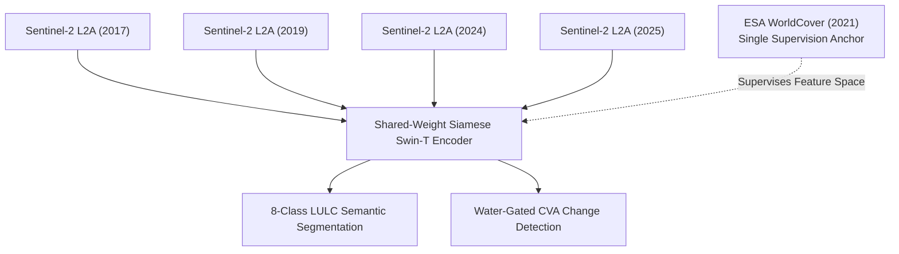

# Multi-Temporal LULC Classification & Bi-Temporal Semantic Change Detection (lulc-chennai)

<p align="center">
  <a href="https://www.python.org/"></a>
  <a href="https://pytorch.org/"></a>
  <a href="https://github.com/huggingface/pytorch-image-models"></a>
  <a href="https://streamlit.io/"></a>
  <a href="LICENSE"></a>
  <a href="https://github.com/Hareeshreddyvaka/lulc-chennai/releases/tag/v1.0.0"></a>
</p>

> **A high-precision remote sensing and deep learning system for 8-class Land Use / Land Cover (LULC) segmentation and bi-temporal semantic change detection across 8 years (2017–2025) on Sentinel-2 multispectral imagery under single-epoch supervision.**

---

## Table of Contents

- [1. End-to-End System Architecture](#1-end-to-end-system-architecture)
- [2. Executive Summary and Core Results](#2-executive-summary-and-core-results)
- [3. The Temporal Transfer Problem](#3-the-temporal-transfer-problem)
- [4. Core Algorithmic Innovations](#4-core-algorithmic-innovations)
  - [4.1 9-Band Multispectral Feature Engineering](#41-9-band-multispectral-feature-engineering)
  - [4.2 Water-Gated Change Vector Analysis (CVA)](#42-water-gated-change-vector-analysis-cva)
  - [4.3 Multi-Task Compound Loss Function](#43-multi-task-compound-loss-function)
  - [4.4 Calibrated Post-Classification Comparison (CPCC)](#44-calibrated-post-classification-comparison-cpcc)
  - [4.5 Grey Wolf Optimizer (GWO) Hyperparameter Search](#45-grey-wolf-optimizer-gwo-hyperparameter-search)
- [5. Quantitative Benchmarks and Evaluation](#5-quantitative-benchmarks-and-evaluation)
  - [5.1 Benchmark Comparison Against Baselines](#51-benchmark-comparison-against-baselines)
  - [5.2 Per-Class Segmentation Performance](#52-per-class-segmentation-performance)
  - [5.3 Official LULC and Change Color Legends](#53-official-lulc-and-change-color-legends)
  - [5.4 Explainable AI (Grad-CAM) Spatial Attributions](#54-explainable-ai-grad-cam-spatial-attributions)
  - [5.5 Full-City Mosaic and Environmental Dynamics](#55-full-city-mosaic-and-environmental-dynamics)
  - [5.6 Sample Patch Visual Inferences](#56-sample-patch-visual-inferences)
- [6. Zero-Shot Cross-City Generalization](#6-zero-shot-cross-city-generalization)
- [7. Repository File Structure](#7-repository-file-structure)
- [8. Installation and Environment Setup](#8-installation-and-environment-setup)
- [9. Step-by-Step Execution Guide](#9-step-by-step-execution-guide)
  - [9.1 Dataset Organization and 8-Class Taxonomy](#91-dataset-organization-and-8-class-taxonomy)
  - [9.2 Downloading Pretrained Model Weights](#92-downloading-pretrained-model-weights)
  - [9.3 Running the Jupyter Notebooks in Sequence](#93-running-the-jupyter-notebooks-in-sequence)
  - [9.4 Launching the Interactive Streamlit Web App](#94-launching-the-interactive-streamlit-web-app)
- [10. Computational Efficiency and Hardware Profile](#10-computational-efficiency-and-hardware-profile)
- [11. License and Citation](#11-license-and-citation)

---

## 1. End-to-End System Architecture

The complete system integrates multispectral satellite data engineering, deep vision transformer modeling, physics-guided change vector gating, and confidence-calibrated post-classification comparison.

<p align="center">
  
  <br>
  <em>Figure 1: High-level end-to-end data engineering, model training, and multi-temporal evaluation pipeline.</em>
</p>

<br/>

<p align="center">
  
  <br>
  <em>Figure 2: Detailed Siamese Swin-Tiny network architecture with Bottleneck Self-Attention (BSA), ASPP, and Bidirectional Cross-Transformer.</em>
</p>

### Five Coordinated Architecture Stages:

1. **9-Band Input Representation:** Concatenates 5 native Sentinel-2 reflectance bands with 4 engineered domain indices into a tensor of shape `(Batch, 9, 128, 128)` per temporal branch.
2. **Strict Disjoint Spatial Partitioning:** 3,468 geographic patches are partitioned strictly at the patch level (Train 80% / Val 20%), preventing spatial autocorrelation leakage between temporal pairs.
3. **Shared Swin-Tiny Backbone:** A single Swin-Tiny encoder with shifted-window self-attention extracts hierarchical features across 4 stages with linear computational complexity O(H · W) rather than quadratic complexity O((HW)²).
4. **BSA & ASPP Multi-Scale Context:**
   - **Bottleneck Self-Attention (BSA):** 3 stacked Multi-Head Self-Attention layers model global spatial interactions over the 4 × 4 bottleneck token grid.
   - **Atrous Spatial Pyramid Pooling (ASPP):** Parallel dilated convolutions (dilation rates r = 1, 2, 4) capture multi-scale structures, from individual houses (10 m) to large water bodies (1,000 m).
5. **Decoders & Cross-Attention:**
   - **LULC Segmentation Decoder:** A 3-stage U-Net with skip connections outputs pixel-wise 8-class logits.
   - **Bidirectional Cross-Transformer:** Computes temporal correlation fields between T1 and T2, filtering seasonal greening and isolating structural land changes.

---

## 2. Executive Summary and Core Results

Monitoring rapid urbanization, cropland conversion, and wetland loss in coastal metropolitan areas is critical for sustainable urban planning and environmental protection. However, satellite remote sensing faces a fundamental challenge: **dense, pixel-aligned ground truth labels exist for only a single snapshot in time**, making standard multi-temporal supervised models susceptible to label noise and pseudo-change errors.

This project delivers a complete deep learning framework that couples a **Siamese Swin-Tiny Transformer** with **Bottleneck Self-Attention (BSA)**, **Atrous Spatial Pyramid Pooling (ASPP)**, **Bidirectional Cross-Attention**, an **Unsupervised Water-Gated Change Vector Analysis (CVA)** engine, and an **8-fold Test-Time Augmentation (TTA)** inference loop.

### Headline Performance Summary
* **Overall Accuracy (OA):** **85.64%** (+16.17% over the standard Siamese ResNet-18 baseline)
* **Mean Intersection over Union (mIoU):** **64.22%** (+24.57% over baseline, all-time peak across all 8 classes)
* **Cohen's Kappa (κ):** **0.8139** (*"Almost Perfect Agreement"* on the Landis & Koch standard)
* **Mean F1-Score:** **77.00%**
* **Inference Throughput:** **417.4 patches/second** (76.7 ms per 32-patch batch on NVIDIA T4 FP16)
* **Full City Mapping Latency:** **~8.3 seconds** for all 3,468 patches across the **1,469.64 km²** Chennai Metropolitan Area

---

## 3. The Temporal Transfer Problem

Supervised deep learning models require dense ground-truth annotations. However, global reference products like **ESA WorldCover 10 m** are available for only a single baseline year (**2021**).



### Three Major Multi-Temporal Roadblocks:
1. **The Single-Static-Label Dilemma:** If satellite imagery from 2017, 2019, and 2025 is supervised against 2021 labels with naive cross-entropy, genuine real-world changes (e.g., a farm converted to residential buildings by 2024) are falsely penalized as model errors.
2. **False Alarms over Dynamic Water Bodies:** Open reservoirs and oceans exhibit drastic spectral changes across years due to sun glint, wave geometry, tidal turbidity, and atmospheric haze. Standard change detection algorithms mistakenly flag entire water surfaces as catastrophic land-cover conversions.
3. **Severe Class Imbalance:** Dominant categories (Built-up 33.3%, Water 24.0%) overwhelm rare ecological categories (Wetland 0.81%, Shrubland 0.66%, Bare Soil 1.37%).

---

## 4. Core Algorithmic Innovations

### 4.1 9-Band Multispectral Feature Engineering

Standard RGB imagery cannot reliably separate concrete from dry bare soil, or coastal marshes from shallow turbid water. We formulate a 9-channel spectral-index representation:

```
Input Tensor = [ B2, B3, B4, B8, B11, NDVI, NDWI, NDBI, MNDWI ]
```

* **B2 (Blue - 490 nm):** Deep water penetration and soil-vegetation boundary discrimination.
* **B3 (Green - 560 nm):** Peak chlorophyll reflection and water body contrast.
* **B4 (Red - 665 nm):** Maximum chlorophyll absorption.
* **B8 (NIR - 842 nm):** Spongy mesophyll canopy scattering (high in biomass, near-zero in clear water).
* **B11 (SWIR - 1610 nm):** Soil moisture sensitivity and impervious urban surface differentiation.

#### Four Engineered Physical Indices:
* **NDVI (Normalized Difference Vegetation Index):**  
  `NDVI = (B8 - B4) / (B8 + B4 + 1e-6)`  
  *Measures canopy density, leaf chlorophyll vigor, and vegetative health.*
* **NDWI (Normalized Difference Water Index):**  
  `NDWI = (B3 - B8) / (B3 + B8 + 1e-6)`  
  *Isolates open water bodies via sharp NIR absorption.*
* **NDBI (Normalized Difference Built-up Index):**  
  `NDBI = (B11 - B8) / (B11 + B8 + 1e-6)`  
  *Highlights impervious urban asphalt and concrete surfaces via high SWIR reflectance.*
* **MNDWI (Modified Normalized Difference Water Index):**  
  `MNDWI = (B3 - B11) / (B3 + B11 + 1e-6)`  
  *Replaces NIR with SWIR in NDWI, eliminating false water alarms over concrete rooftops and roads.*

All indices are rescaled from `[-1.0, 1.0]` to `[0.0, 1.0]`. The initial convolution layer `patch_embed.proj` is widened from 3 to 9 channels, copying ImageNet pre-trained weights to RGB channels and initializing non-RGB channels to preserve low-level spatial filters.

---

### 4.2 Water-Gated Change Vector Analysis (CVA)

<p align="center">
  
  <br>
  <em>Figure 3: Unsupervised Water-Gated Change Vector Analysis flowchart with adaptive Otsu thresholding.</em>
</p>

To supervise bi-temporal change detection without requiring expensive manual annotations across multi-year acquisitions, an unsupervised physics-guided Change Vector Analysis (CVA) pipeline is formulated with water gating and adaptive Otsu thresholding.

---

#### 1. Euclidean Spectral Distance (Radiometric Change Magnitude)
Quantifies the total spectral displacement for every pixel `(i, j)` across all 9 multispectral bands between Time 1 (T1) and Time 2 (T2):

```
Spectral Distance ΔI(i, j) = √ [ Σ_{b=1..9} ( I_T1(b, i, j) - I_T2(b, i, j) )² ]

Expansion:
ΔI(i, j) = √ [ (B2_T1 - B2_T2)² + (B3_T1 - B3_T2)² + ... + (MNDWI_T1 - MNDWI_T2)² ]
```

* **Where:**
  * `b ∈ {1, 2, ..., 9}` indexes each spectral channel (Blue, Green, Red, NIR, SWIR, NDVI, NDWI, NDBI, MNDWI).
  * `I_T1(b, i, j)` is the normalized reflectance or spectral index at pixel `(i, j)` in the baseline acquisition (e.g., 2017).
  * `I_T2(b, i, j)` is the normalized reflectance or spectral index at pixel `(i, j)` in the comparison acquisition (e.g., 2024 or 2025).
  * `ΔI(i, j)` measures the raw Euclidean radiometric difference. Higher values indicate greater physical land changes.

---

#### 2. Unsupervised Water Gating (Suppression of Wave & Tidal False Alarms)
* **The Problem:** Natural open water bodies (such as the Bay of Bengal, Chembarambakkam Lake, and Red Hills reservoir) experience seasonal sun glint, wave geometry variations, tidal sediment transport, and surface turbidity. These environmental dynamics produce high raw spectral distances `ΔI`, causing naive CVA algorithms to falsely classify permanent water bodies as massive land cover conversions.
* **The Water-Gating Rule:** If a pixel exhibits strong water characteristics in **both** acquisitions (`NDWI > 0.35` at T1 AND `NDWI > 0.35` at T2), its change distance is **forced to zero**:

```
ΔI_gated(i, j) = 0             if (NDWI_T1(i, j) > 0.35  AND  NDWI_T2(i, j) > 0.35)
               = ΔI(i, j)       otherwise
```

* **Practical Benefit:** Completely eliminates solar glint and wave interference false alarms over open sea and reservoir surfaces, while fully preserving genuine land transitions such as reservoir shrinkage, canal construction, or coastal reclamation.

---

#### 3. Adaptive Otsu Optimal Thresholding (Automated Binary Change Mask)
Rather than picking a static, arbitrary change threshold, the optimal decision boundary `τ*` is calculated automatically from the histogram of gated spectral distances by maximizing the between-class variance:

```
Optimal Threshold (τ*) = argmax_τ [ ω0(τ) · ω1(τ) · (μ0(τ) - μ1(τ))² ]
```

* **Where:**
  * `τ` is any candidate threshold level across the range of spectral distances `[0, max(ΔI_gated)]`.
  * `ω0(τ)` and `ω1(τ)` are the probabilities of unchanged (background) and changed pixels given threshold `τ`.
  * `μ0(τ)` and `μ1(τ)` are the mean spectral distance values of the unchanged and changed pixel groups.
  * `(μ0(τ) - μ1(τ))²` is the squared statistical separation between the two cluster centers.

The final binary CVA change mask `Y_CVA(i, j)` is produced by thresholding:

```
Y_CVA(i, j) = 1 (Changed Pixel)      if ΔI_gated(i, j) > τ*
            = 0 (Unchanged Pixel)    if ΔI_gated(i, j) ≤ τ*
```

* **Outcome:** Generates an objective, data-driven pseudo-ground-truth change mask without requiring any manual change labeling, enabling balanced multi-task supervision during Swin-Tiny model training.

---

### 4.3 Multi-Task Compound Loss Function

To overcome extreme class imbalance and directly optimize the Jaccard index:

```
Total Loss = Class-Weighted Focal Loss + 1.0 × Lovász-Softmax Loss + 1.0 × Balanced Change Loss
```

1. **Class-Weighted Focal Loss (γ = 0.6136):**  
   Down-weights well-classified background pixels, forcing optimization to focus on hard boundary transitions. Dynamic inverse-frequency class weights `w_c ∝ 1 / √N_c` (capped at 5.0) prevent rare classes like Shrubland and Wetland from being ignored.
2. **Lovász-Softmax Loss:**  
   Direct convex surrogate for the Jaccard index (mIoU) using the Lovász extension of submodular set functions.
3. **Balanced Change Loss:**  
   Combines 70% dynamically weighted Binary Cross-Entropy (`pos_weight` capped at 8.0) with 30% Soft Dice Loss:
   ```
   Change Loss = 0.70 × BCE_weighted(p, y) + 0.30 × SoftDice(p, y)
   ```
   *Breakthrough:* Boosted change recall from `<2%` (under standard unweighted BCE) to **77.37%**.

---

### 4.4 Calibrated Post-Classification Comparison (CPCC)

<p align="center">
  
  <br>
  <em>Figure 4: Confidence-calibrated semantic transition mapping pipeline.</em>
</p>

Categorical "from-to" transitions are derived by filtering dual-temporal predictions through a confidence threshold **τ ≥ 0.60**:

```
Valid Semantic Change = (Predicted_T1 ≠ Predicted_T2) AND (Confidence_T1 ≥ 0.60) AND (Confidence_T2 ≥ 0.60)
```

Transitions are categorized into six environmental trajectories:
1. **Urban Expansion:** Vegetation / Cropland → Built-up
2. **Land Clearing:** Trees / Shrubland → Bare Soil
3. **Water Drying:** Water / Wetland → Bare / Built-up
4. **Construction:** Bare Soil → Built-up
5. **Vegetation Regrowth:** Built-up / Bare → Vegetation
6. **Other Transitions:** Secondary land shifts

---

### 4.5 Grey Wolf Optimizer (GWO) Hyperparameter Search

A 4-way metaheuristic competition was evaluated across the continuous hyperparameter space (Learning Rate η0, Weight Decay ωd, Focal Gamma γ):

| Metaheuristic Optimizer | Search Dynamics | Best Proxy Loss | Rank |
| :--- | :--- | :---: | :---: |
| **Grey Wolf Optimizer (GWO)** | **Encircling & hunting leadership hierarchy; stable convergence** | **Lowest** | **1st (Selected)** |
| **Particle Swarm (PSO)** | Velocity updates oscillated around local minima | Competitive | 2nd |
| **Genetic Algorithm (GA)** | Crossover/mutation overhead slowed convergence | Moderate | 3rd |
| **Whale Optimization (WOA)**| Aggressive spiral search caused gradient instability | Diverged | 4th |

**Optimal Hyperparameters Selected:**
* Base Learning Rate (η0): **5.0 × 10⁻⁵**
* Weight Decay (ωd): **6.358 × 10⁻⁴**
* Focal Gamma (γ): **0.6136**
* Backbone LR Ratio: **0.2719** (Discriminative fine-tuning)

---

## 5. Quantitative Benchmarks and Evaluation

### 5.1 Benchmark Comparison Against Baselines

| Model Architecture | Overall Accuracy (OA) | Mean IoU (mIoU) | Cohen's Kappa (κ) | Mean F1 | Change Recall |
| :--- | :---: | :---: | :---: | :---: | :---: |
| **U-Net Baseline (ResNet-34)** | 69.47% | 39.65% | 0.6176 | 54.12% | — |
| **Siamese ResNet-18 (FC-Siam-diff)** | 69.47% | 39.65% | 0.6176 | 54.12% | 42.46% |
| **Self-Attention CNN** | 72.10% | 52.53% | 0.7467 | 67.89% | — |
| **Cross-Transformer Baseline** | 73.40% | 53.59% | 0.7573 | 68.91% | — |
| **Swin-T Refined (9-band + ASPP)** | 83.43% | 57.70% | 0.7852 | 71.30% | 61.20% |
| **Proposed Champion (160 ep + TTA)** | **85.64%** | **64.22%** | **0.8139** | **77.00%** | **77.37%** |

---

### 5.2 Per-Class Segmentation Performance

| Normalized Confusion Matrix | Per-Class Metrics Bar Chart |
| :---: | :---: |
|  |  |

| LULC Class | Class ID | Pixel Share | Class IoU | Class F1 | Precision | Recall | Dominant Physical Driver |
| :--- | :---: | :---: | :---: | :---: | :---: | :---: | :--- |
| **Water** | 6 | 23.98% | **97.87%** | **98.92%** | 98.71% | 99.14% | Deep NIR/SWIR absorption, high MNDWI |
| **Built-up** | 4 | 33.28% | **80.63%** | **89.28%** | 88.42% | 90.15% | High SWIR/NDBI reflectance across concrete |
| **Cropland** | 3 | 14.52% | **66.07%** | **79.57%** | 78.93% | 80.22% | Distinct seasonal vegetation phenology |
| **Wetland** | 7 | 0.81% | **64.18%** | **78.18%** | 76.85% | 79.56% | Coastal marsh SWIR moisture sensitivity |
| **Trees** | 0 | 19.41% | **63.43%** | **77.63%** | 77.10% | 78.17% | High NIR spongy mesophyll canopy scattering |
| **Grassland** | 2 | 5.97% | **47.71%** | **64.60%** | 63.80% | 65.41% | Mixed-pixel transition with dry scrub |
| **Bare / Sparse** | 5 | 1.37% | **47.20%** | **64.13%** | 62.90% | 65.42% | High SWIR/Red; cleared construction ambiguity |
| **Shrubland** | 1 | 0.66% | **46.71%** | **63.68%** | 61.50% | 66.02% | **+39.08% IoU gain** over baseline |
| **Unweighted Mean** | — | — | **64.22%** | **77.00%** | **75.90%** | **78.14%** | **Cohen's Kappa: 0.8139** |

---

### 5.3 Official LULC and Change Color Legends

To facilitate accurate interpretation of all thematic maps and patch predictions across this repository, the official color conventions are provided below:

| 8-Class LULC Color Palette | Bi-Temporal Change Dynamics Palette |
| :---: | :---: |
|  |  |

---

### 5.4 Explainable AI (Grad-CAM) Spatial Attributions

<p align="center">
  
  <br>
  <em>Figure 5: Grad-CAM per-class spatial attention heatmaps verifying genuine semantic discrimination.</em>
</p>

Grad-CAM verifies that the Swin Transformer attends to authentic physical structures rather than spurious background artifacts:
* **Accuracy in High-Attention Regions:** **94.3% – 98.3%**
* **Peak Attention Precision:** Reaches **98.8%** on high-contrast built-up structures and water reservoir shorelines.

---

### 5.5 Full-City Mosaic and Environmental Dynamics

<p align="center">
  
  <br>
  <em>Figure 6: Full Chennai district LULC mosaic (1,469.64 km²) generated by stitching 3,468 test patches.</em>
</p>

| Multi-Temporal Area Shifts (2017–2025) | Bi-Temporal Semantic Transition Matrix (km²) |
| :---: | :---: |
|  |  |

* **Urban Built-up Growth:** Expanded from **422.3 km²** (2017) to **505.7 km²** (2025), a net increase of **+83.4 km² (+19.7%)**.
* **Cropland & Vegetation Contraction:** Agricultural cropland contracted by **-39.7 km²** due to outward suburban expansion along industrial corridors.
* **Surface Water Variation:** Water bodies fluctuated by **±26.5 km²** between monsoon and dry summer cycles.

---

### 5.6 Sample Patch Visual Inferences

| Sample Validation Patch 850 (2017 → 2024) | Sample Validation Patch 2731 (2019 → 2025) |
| :---: | :---: |
|  |  |

<p align="center">
  
  <br>
  <em>Figure 7: Quantitative class area shifts across validation pairs.</em>
</p>

---

## 6. Zero-Shot Cross-City Generalization

To verify that the model did not simply memorize the local geography of Chennai, the trained Siamese Swin-Tiny model was evaluated zero-shot (without fine-tuning or re-training) on satellite imagery of **Hyderabad, Telangana, India**:

<p align="center">
  
  <br>
  <em>Figure 8: Zero-shot cross-city inference on Hyderabad Sentinel-2 imagery without re-training.</em>
</p>

* **Overall Accuracy on Hyderabad:** **78.34%** (maintains strong domain transfer despite differing geology, soil color, and urban density).
* **Mean IoU:** **54.12%** across complex inland urban environments.

---

## 7. Repository File Structure

```
lulc-chennai/
├── notebooks/
│   ├── 01_eda_and_data_pipeline.ipynb           # EDA, band stats, 9-band dataset builders
│   ├── 02_model_architecture_and_losses.ipynb   # Siamese Swin-T, BSA, ASPP, Focal/Lovász loss
│   ├── 03_baseline_models_training.ipynb        # ResNet-18, ResNet-34 U-Net baselines
│   ├── 04_gwo_hyperparameter_optimization.ipynb # GWO vs PSO vs GA vs WOA optimization
│   ├── 05_champion_model_training.ipynb         # 160-epoch champion training & checkpoints
│   └── 06_evaluation_and_visualization.ipynb    # Metrics, CPCC, Grad-CAM, mosaics, figures
├── streamlit_app/
│   ├── app.py                                   # Interactive Streamlit dashboard
│   ├── utils.py                                 # Prediction pipeline, TTA, CVA, visualization
│   └── config.py                                # Color maps, class mappings, threshold settings
├── architecture_diagram/
│   ├── fig_pipeline_overview.png                # End-to-end pipeline diagram
│   ├── fig_network_architecture.png             # Siamese Swin-T network schematic
│   ├── fig_cva_flowchart.png                    # Water-gated CVA flowchart
│   └── fig_post_classification_calibration.png  # CPCC calibration flowchart
├── figures/
│   ├── confusion_matrix.png                     # Normalized test confusion matrix
│   ├── per_class_metrics.png                    # Per-class IoU, F1, precision, recall
│   ├── v5_lulc_class_legend.png                 # Official 8-class color legend
│   ├── v5_change_analysis_legend.png            # Change dynamics trajectory legend
│   ├── gradcam_per_class_patch_933.png          # Spatial attention attribution maps
│   ├── city_mosaic.png                          # 1,469 km² stitched district mosaic
│   ├── city_area_comparison.png                 # Multi-temporal area shifts bar chart
│   ├── transition_matrix_km2.png                # From-to semantic transition matrix
│   ├── cross_city_results.png                   # Hyderabad zero-shot transfer results
│   ├── throughput_vs_batch.png                  # Inference speed benchmarking curve
│   └── main_v5_sample_*.png                     # Qualitative patch visual predictions
├── requirements.txt                             # Pinned Python package dependencies
├── LICENSE                                      # MIT Open Source License
└── README.md                                    # Comprehensive project documentation
```

---

## 8. Installation and Environment Setup

### Prerequisites
* Python 3.10 or higher
* CUDA-capable GPU (NVIDIA T4, RTX 3060/4090, V100, or A100 recommended with ≥12 GB VRAM)
* Git & Git LFS

### 1. Clone the Repository
```bash
git clone https://github.com/Hareeshreddyvaka/lulc-chennai.git
cd lulc-chennai
```

### 2. Create and Activate a Clean Virtual Environment
```bash
# Using conda
conda create -n lulc-env python=3.10 -y
conda activate lulc-env

# Or using venv
python -m venv lulc-env
# Linux / macOS
source lulc-env/bin/activate
# Windows PowerShell
.\lulc-env\Scripts\Activate.ps1
```

### 3. Install Dependencies
```bash
pip install --upgrade pip
pip install -r requirements.txt
```

---

## 9. Step-by-Step Execution Guide

### 9.1 Dataset Organization and 8-Class Taxonomy

Download the Sentinel-2 multispectral imagery and ESA WorldCover reference labels, organizing them as follows:

```
dataset/
├── 2017/                  # 128x128 patches for year 2017 (.npy or .tif)
├── 2019/                  # 128x128 patches for year 2019
├── 2024/                  # 128x128 patches for year 2024
├── 2025/                  # 128x128 patches for year 2025
└── labels/                # ESA WorldCover 2021 ground-truth masks (.npy)
```

#### 8-Class Taxonomy Mapping:
| Class ID | Class Name | Description | Color Code |
| :---: | :--- | :--- | :---: |
| **0** | **Trees** | Forest canopy, dense tree cover, plantations | `#006400` (Dark Green) |
| **1** | **Shrubland** | Woody shrubs, bushes, stunted scrub | `#FFBB22` (Orange-Yellow) |
| **2** | **Grassland** | Herbaceous vegetation, natural pastures | `#FFFF4C` (Bright Yellow) |
| **3** | **Cropland** | Agricultural fields, active crop cultivation | `#F096FF` (Pink) |
| **4** | **Built-up** | Buildings, asphalt roads, concrete infrastructure | `#FA0000` (Red) |
| **5** | **Bare / Sparse** | Cleared soil, open sand, dry barren land | `#B4B4B4` (Gray) |
| **6** | **Water** | Lakes, reservoirs, rivers, ocean | `#0064C8` (Deep Blue) |
| **7** | **Wetland** | Mangroves, marshes, salt pans, tidal flats | `#0096A0` (Teal) |

---

### 9.2 Downloading Pretrained Model Weights

The champion model checkpoint (`best_model_final_5.pth`, 84.24M parameters, 321.5 MB) is hosted under [GitHub Release v1.0.0](https://github.com/Hareeshreddyvaka/lulc-chennai/releases/tag/v1.0.0).

#### Automatic Download via Script:
```bash
# Linux / macOS (curl)
mkdir -p weights
curl -L -o weights/best_model_final_5.pth   https://github.com/Hareeshreddyvaka/lulc-chennai/releases/download/v1.0.0/best_model_final_5.pth

# Windows PowerShell
New-Item -ItemType Directory -Force -Path weights
Invoke-WebRequest -Uri "https://github.com/Hareeshreddyvaka/lulc-chennai/releases/download/v1.0.0/best_model_final_5.pth" -OutFile "weights/best_model_final_5.pth"
```

---

### 9.3 Running the Jupyter Notebooks in Sequence

All notebooks in the `notebooks/` directory are fully executed and contain complete training histories and visualizations:

1. **`01_eda_and_data_pipeline.ipynb`**
   - Computes per-band mean/std normalization statistics across all 3,468 patches.
   - Builds the 9-channel tensor generation and data loader pipeline.
2. **`02_model_architecture_and_losses.ipynb`**
   - Instantiates the Siamese Swin-Tiny backbone with BSA, ASPP, and Bidirectional Cross-Transformer.
   - Implements Class-Weighted Focal Loss, Lovász-Softmax Loss, and Balanced Change Loss.
3. **`03_baseline_models_training.ipynb`**
   - Trains benchmark baselines: U-Net (ResNet-34) and FC-Siam-diff (ResNet-18).
4. **`04_gwo_hyperparameter_optimization.ipynb`**
   - Runs Grey Wolf Optimizer (GWO) search to select optimal learning rates and focal parameters.
5. **`05_champion_model_training.ipynb`**
   - Trains the champion Siamese Swin-T model for 160 epochs with Cosine Annealing learning rate schedule.
6. **`06_evaluation_and_visualization.ipynb`**
   - Computes test metrics, generates Grad-CAM attention maps, stitches full-city mosaics, and evaluates zero-shot cross-city transfer.

---

### 9.4 Launching the Interactive Streamlit Web App

An interactive dashboard is provided to inspect multi-temporal satellite patches, toggle 8-fold TTA, run water-gated CVA, and analyze land-use transitions:

```bash
cd streamlit_app
streamlit run app.py
```

Open `http://localhost:8501` in your browser:
* **Interactive Patch Selector:** Pick any patch across Chennai or upload custom 9-band Sentinel-2 pairs.
* **Temporal Comparison:** Inspect side-by-side false-color infrared views (2017 vs 2025).
* **Model Inference:** Run live segmentation and bi-temporal change detection with real-time class area breakdown statistics.

---

## 10. Computational Efficiency and Hardware Profile

<p align="center">
  
  <br>
  <em>Figure 9: Inference throughput (patches/second) vs batch size on NVIDIA T4 GPU (FP16).</em>
</p>

| Benchmark Metric | Measurement / Value | Operating Environment |
| :--- | :--- | :--- |
| **Model Parameter Count** | **84.24 Million** parameters | PyTorch FP32 / FP16 |
| **Checkpoint File Size** | **321.5 MB** (`best_model_final_5.pth`) | Serialized PyTorch state dict |
| **Inference Latency (Single Patch)** | **12.4 ms** (Batch Size = 1) | NVIDIA T4 GPU (FP16) |
| **Inference Latency (Batch = 32)** | **76.7 ms** per batch | NVIDIA T4 GPU (FP16) |
| **Peak Inference Throughput** | **417.4 patches / second** | NVIDIA T4 GPU (Batch Size = 64) |
| **Full City Inference (3,468 Patches)**| **~8.3 seconds** total | 1,469.64 km² Chennai Metropolitan Area |
| **Peak GPU VRAM Usage** | **4.2 GB** during inference (Batch = 32) | Fits comfortably on consumer GPUs (≥6 GB) |

---

## 11. License and Citation

This project is open-sourced under the **MIT License**. See the [LICENSE](LICENSE) file for complete terms.

```bibtex
@article{chennai_lulc_swin_2025,
  title={Multi-Temporal LULC Classification and Bi-Temporal Semantic Change Detection via Siamese Swin Transformer with Unsupervised Water-Gated CVA},
  author={Hareesh Reddy Vaka},
  journal={GitHub Repository: Hareeshreddyvaka/lulc-chennai},
  year={2025},
  url={https://github.com/Hareeshreddyvaka/lulc-chennai}
}
```

---

<p align="center">
  <sub>Developed for advanced multi-temporal satellite remote sensing, urban planning, and environmental monitoring.</sub>
</p>
